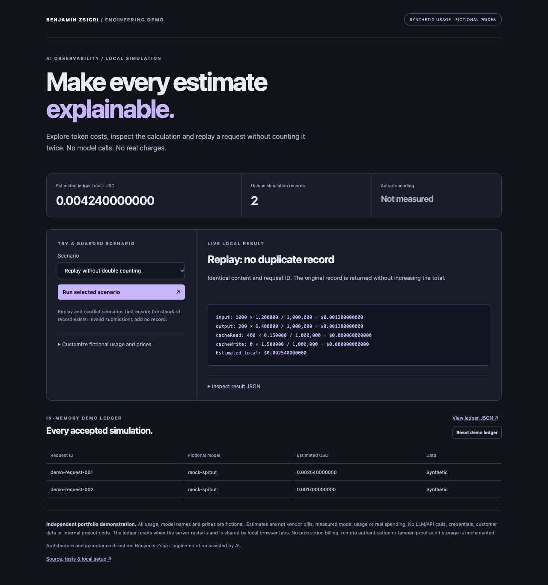

# AI Usage & Cost Explorer

**[Try the live synthetic demo](https://tribloc-ai-costs.pages.dev/)** — no installation or local server required.

## Hosted browser version

The hosted version computes in the visitor's browser. Its ledger stays in that tab and resets on reload; usage records are not sent to a server. This differs from the optional local Node HTTP server below, whose in-memory ledger is shared by its local tabs. The same calculation and replay rules are used. All six preset scenarios passed on the public site; all 49 automated tests passed after the browser-compatible hash update.

Run `npm ci --ignore-scripts` before local use/build; `npm run build` creates the static `dist/` assets. The engine uses the pinned `@noble/hashes` implementation; esbuild is a build-only dependency. [Hosted checks](docs/hosted-checks.json).

A locally runnable demonstration of **exact cost estimates, traceable rate snapshots and replay-aware usage records**. All model names, token usage, project labels and prices are fictional. No provider API is called and no actual spending is measured.



## What it demonstrates

- Four disjoint token buckets: uncached input, output, cache reads and cache writes.
- A visible cost breakdown and the exact fictional rates used for each record.
- Two made-up models with editable prices. These are not real vendor rates.
- Validation before recording: missing context, unlisted models and invalid rates/usage are refused.
- Identical request-ID replay returns the original record without increasing totals. Changed content under the same request ID is refused.
- A local, in-memory ledger with JSON inspection and an explicit reset.

This project was independently implemented for public demonstration. It contains no internal project code, real customer data, private architecture, credentials or production usage records.

## Run locally

Requires Node.js 22+ and npm. Tested with Node.js 24.19.0. Install the pinned packages with `npm ci --ignore-scripts` before running the commands below.

```sh
npm test
npm run demo
npm start
```

Open **http://127.0.0.1:8767/**. `DEMO_PORT=8768 npm start` selects another port. Keep the server terminal open. The server binds only to `127.0.0.1`; this is not a hosted public application.

`npm run demo` prints a repeatable command-line example covering all six preset scenarios. `npm test` includes HTTP tests that temporarily bind an ephemeral loopback port.

## Try the UI

1. Run **Standard usage**. The estimate is exactly `0.002540000000 USD`.
2. Run **More cached input**. This adds a different fictional record; the combined ledger total is `0.004240000000 USD`.
3. Run **Replay without double counting**. The count stays at two and the total does not change.
4. Try missing context, an unlisted model or a changed request ID to see refusals.
5. Expand **Customize fictional usage and prices**, choose a model and enter a new demo request ID. Change a fictional rate and inspect the new breakdown.
6. Inspect the ledger JSON or reset the local synthetic records.

Replay and conflict scenarios first ensure the standard record exists. A refused submission adds no record; any earlier accepted record remains. Reloading the page retains server memory, while a server restart clears the ledger. All local tabs share that same ledger.

## Calculation and data contract

For each bucket:

```text
estimated USD = token count × fictional USD per million tokens / 1,000,000
```

Token buckets must not overlap. Input excludes tokens counted as cache reads/writes. This is a simplified illustration, not an implementation of any vendor's billing semantics.

Counts are integers from 0 to 1,000,000,000 per bucket. Rate inputs are decimal strings from 0 to 1000 fictional USD per million, with up to six fractional digits. Internally, BigInt arithmetic computes amounts in units of `10^-12 USD` and serializes them as decimal strings. Floating-point arithmetic is not used for money calculations or ledger aggregation. Displayed estimates retain twelve fractional digits; there is no invoice rounding.

Context requires a project, workflow and request ID, using bounded demo labels. Model names must be allowlisted even when prices are customized. Each accepted record stores its rate snapshot, bucket estimates, total, timestamp and canonical-input fingerprint. Request IDs are globally unique within this single-process ledger. The fingerprint binds replay detection to context, model, usage and rates; it is **not** a digital signature or tamper-proof audit guarantee. At most 1000 unique records are retained until reset/restart.

The HTTP layer serves allowlisted UI assets, enforces a small JSON-body limit, checks local Host/Origin/Fetch Metadata and returns refusal codes without echoing invalid submitted values. These are focused local-demo controls, not a comprehensive security assessment.

## Validation evidence

On **2026-10-17**, all **49 automated tests** passed:

- Exact bucket calculations, zero usage, sub-cent precision and maximum bounds.
- Missing/extra fields, wrong types, non-finite/fractional/negative/oversized usage and invalid prices.
- Replay, changed-content conflicts, unique-record totals, record isolation, capacity and reset.
- HTTP scenarios, invalid JSON, size/content-type limits, local-request checks and route/method restrictions.

**12 browser checks** also passed: six preset scenarios, custom prices, model switching, custom replay, invalid price, invalid usage and reset.

Evidence: [automated report](docs/test-report.txt), [browser checks](docs/browser-checks.json), [recorded CLI sample](docs/sample-results.json). The screenshot and CLI sample are recorded examples; the running UI performs fresh calculations.

## Limits and attribution

No LLM calls, model telemetry, vendor billing reconciliation, payment processing, customer systems or external CRM are connected. This does not demonstrate real savings, production spend controls or client results. No remote authentication, multi-tenant isolation, persistent storage or production deployment is included. Do not use this demonstration as a billing system or expose the local server publicly.

Architecture, scope and acceptance direction: **Benjamin Zsigri**. Implementation assisted by AI. This is an independent public portfolio sample, not a client engagement or a published copy of a private system.
